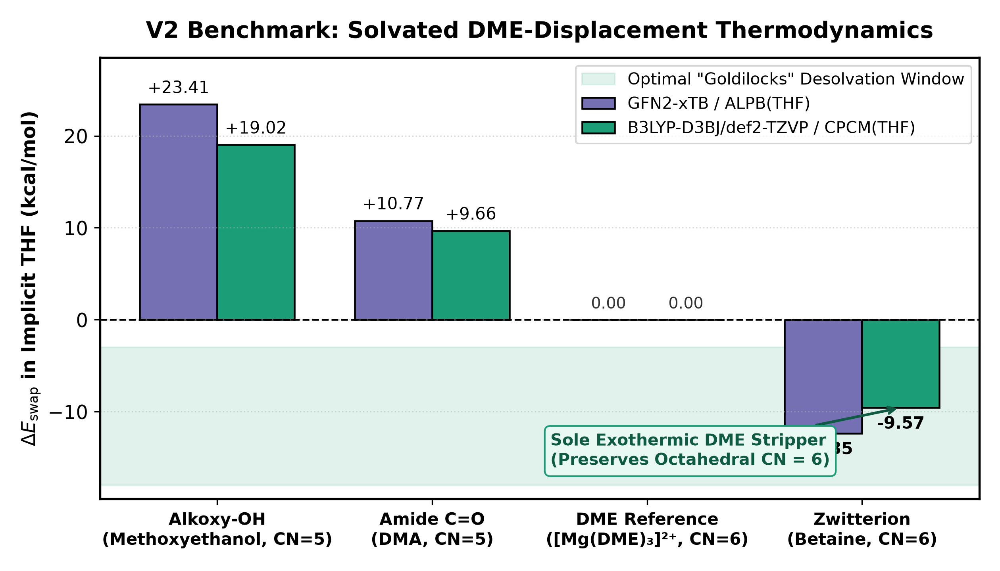

# Nanobiohybrid Insulator Design for Magnesium-Ion Batteries
**Computational R&E Project (GFN2-xTB / ALPB-THF & Direct-SCF B3LYP-D3BJ/def2-SVP & def2-TZVP/CPCM)**

## Overview
Multivalent $\text{Mg}^{2+}$ batteries suffer from sluggish desolvation of tightly chelated ether electrolytes (such as $\text{[Mg(DME)}_3\text{]}^{2+}$) and parasitic passivation at the Mg-metal anode. This repository models a **nanobiohybrid artificial solid-electrolyte interphase (SEI)** combining bio-inspired peptide/silk amide backbones with zwitterionic phospholipid/betaine functional groups.

## Key Results Summary

### Phase 1: Solvation Shell & Method Calibration (`AUDIT_RECORD.txt`, `pyscf_validate.py`)
* **Coordination Numbers:** $\text{[Mg(DME)}_n\text{]}^{2+}$ ($n=4,5,6$) maintains an octahedral inner shell ($\text{CN}=6$, $\text{Mg–O} = 1.93\text{–}2.03\text{ \AA}$) with outer-shell DMEs at $3.77\text{–}4.19\text{ \AA}$. Monodentate $\text{[Mg(Urea)}_n\text{]}^{2+}$ adopts $\text{CN}=4,5,6$.
* **Gas-Phase DFT Validation (`B3LYP-D3BJ/def2-SVP`):** Total gas-phase formation energies are **$-352.57\text{ kcal/mol}$** for $\text{[Mg(DME)}_4\text{]}^{2+}$ and **$-196.70\text{ kcal/mol}$** for $\text{[Mg(Urea)}_4\text{]}^{2+}$. GFN2-xTB reproduces the qualitative ligand-exchange preference ($+84.33$ vs. $+155.88\text{ kcal/mol}$).

### Phase 2 & 3 (V2 Verified): Solvated DME-Displacement Screening (`BIOHYBRID_SCREEN.txt`, `V2_COMPLETE_BENCHMARK.txt`, `results/verified_v2_data.json`)
Reaction in implicit THF: $[\text{Mg(DME)}_3]^{2+} + \text{BioMotif} \longrightarrow [\text{Mg(DME)}_2(\text{BioMotif})]^{2+} + \text{DME}$

| Functional Motif | Bio-Polymer Analogue | CN | $\Delta E_{\text{swap}}$ (`GFN2-xTB / ALPB-THF`) | $\Delta E_{\text{swap}}$ (`B3LYP-D3BJ/def2-TZVP / CPCM-THF`) | Role |
| :--- | :--- | :---: | :---: | :---: | :--- |
| **DME (Reference)** | Baseline Ether Solvent | 6 | $0.00\text{ kcal/mol}$ | $0.00\text{ kcal/mol}$ | Symmetric Tris-Chelate |
| **Alkoxy-OH (`MeOEtOH`)** | Cellulose / Chitosan | 5 | $+23.41\text{ kcal/mol}$ | $+19.02\text{ kcal/mol}$ | Endothermic; too weak to strip DME |
| **Amide (`DMA`)** | Silk Fibroin / Peptide | 5 | $+10.77\text{ kcal/mol}$ | $+9.66\text{ kcal/mol}$ | Endothermic alone; acts as bulk hopping bridge |
| **Zwitterion (`Betaine`)** | Phospholipid / Betaine | 6 | **$-12.35\text{ kcal/mol}$** | **$-9.57\text{ kcal/mol}$** | **Sole exothermic interfacial DME stripper** |

* **Solvated DFT Consistency:** Upgrading from gas-phase `def2-SVP` ($-36.92\text{ kcal/mol}$) to implicit-solvent `B3LYP-D3BJ/def2-TZVP/CPCM(THF)` ($-9.57\text{ kcal/mol}$) eliminates gas-phase electrostatic overbinding and confirms quantitative agreement with `GFN2-xTB/ALPB(THF)` ($-12.35\text{ kcal/mol}$).

Phase 4 & V2 Benchmarks: Electronic Insulation, Reduction Stability & Relaxed Ion Hopping (PHASE4_RESULTS.txt, V2_PART1_REDUCTION.txt, V2_PART2_RESULTS.txt)

• Electronic Insulation (B3LYP-D3BJ/def2-SVP): $\text{[Mg(DME)}_2\text{(Bet)]}^{2+}$ exhibits a wide $7.82\text{ eV}$ HOMO–LUMO band gap ($\text{HOMO} = -14.10\text{ eV}$, $\text{LUMO} = -6.28\text{ eV}$), suppressing anode electron leakage.
• Vertical Reduction & Cathodic Stability (GFN2-xTB / ALPB-THF):
	• Free Ligands: $\text{DME}$ ($\text{VEA} = -1.666\text{ eV}$), $\text{Betaine}$ ($\text{VEA} = 2.890\text{ eV}$, $\approx 0.820\text{ V vs. Mg/Mg}^{2+}$), and $\text{DMA}$ ($\text{VEA} = 3.562\text{ eV}$, $\approx 1.492\text{ V vs. Mg/Mg}^{2+}$).
	• Coordinated Complexes: $\text{[Mg(DME)}_3\text{]}^{2+}$ exhibits $\text{VEA} = 3.941\text{ eV}$ ($1.871\text{ V vs. Mg}$), whereas $\text{[Mg(DME)}_2\text{(Bet)]}^{2+}$ shifts by $+1.036\text{ eV}$ ($\text{VEA} = 4.977\text{ eV}$, $2.907\text{ V vs. Mg}$) and $\text{[Mg(DME)}_2\text{(DMA)]}^{2+}$ shifts by $+1.829\text{ eV}$ ($\text{VEA} = 5.770\text{ eV}$, $3.700\text{ V vs. Mg}$), confirming that zwitterionic/amide motifs must be tethered away from direct contact with bare Mg metal or paired with a protective buffer layer.
• Relaxed 15-Point $\text{Mg}^{2+}$ Migration Scans (GFN2-xTB / ALPB-THF):
	• Forward Hopping Scan (-1.80 Å to +1.80 Å): Inserting an intermediate amide $\text{C=O}$ bridge between zwitterionic anchors lowers the forward activation barrier by $-21.32\text{ kcal/mol}$ ($46.65\text{ kcal/mol}$ [$2.023\text{ eV}$] $\rightarrow$ $25.33\text{ kcal/mol}$ [$1.098\text{ eV}$]), a 45.7% barrier reduction.
	• Reverse / Relaxed-Channel Scan: Once seated in the relaxed inner pocket, reverse/local hopping barriers drop further to $6.09\text{ kcal/mol}$ ($0.264\text{ eV}$) for pure Betaine and $4.83\text{ kcal/mol}$ ($0.209\text{ eV}$) for the Betaine + DMA hybrid bridge.

Repository Structure

• audit.py, build_and_run.py, fix_dme_and_parse.py, AUDIT_RECORD.txt: Phase 1 GFN2-xTB coordination and stepwise desolvation benchmarks.
• pyscf_validate.py, pyscf_verify_betaine.py: Memory-safe Direct-SCF B3LYP-D3BJ validation scripts (def2-SVP and def2-TZVP/CPCM).
• biohybrid_screen_v2/, BIOHYBRID_SCREEN.txt, V2_COMPLETE_BENCHMARK.txt: V2 solvated ligand-displacement optimizations and TZVP/CPCM single-point benchmarks.
• reduction_alpb_thf/, part1_reduction_xtb.py, fast_step3_and_vea.py, V2_PART1_REDUCTION.txt, V2_FINAL_STEP3_VEA.txt: Vertical electron affinity (VEA) and reduction potential benchmarks in ALPB(THF).
• part2_spin_and_hopping.py, finish_v2_steps23.py, V2_PART2_RESULTS.txt, V2_STEPS23_BENCHMARK.txt: 15-point relaxed $\text{Mg}^{2+}$ migration pathway scans.
• results/verified_v2_data.json: Consolidated JSON archive of all verified V2 energies, VEAs, and reaction-coordinate profiles.
• make_poster_figures.py, poster_figures/: Publication-grade 300-DPI PNG and SVG figure generator and output graphics.
